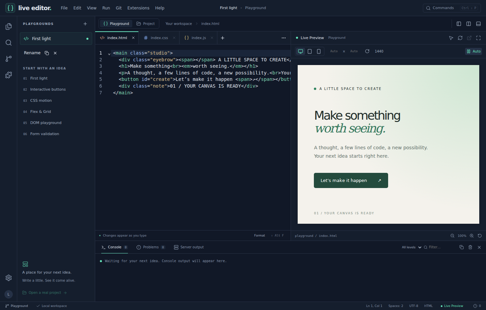

# Renderift · Live Editor

**Write. See. Ship.** A local desktop coding studio for Windows 10/11 and Linux x64, built with Tauri 2, Rust, Svelte, TypeScript and CodeMirror 6. Repository name: `live-editor`.

> **Development candidate, not a certified stable release.** The source implements the application workflows below. Verification status, remaining acceptance gaps and platform limitations are recorded in [QA-REPORT](docs/QA-REPORT.md). No published release or successful GitHub CI run is implied.



## What works

- HTML/CSS/JavaScript playgrounds with six offline templates, multiple sessions, recovery, import, and HTML/separate-file/ZIP export.
- Live isolated preview, CSS injection that preserves JavaScript state, responsive widths, custom dimensions, rotation, zoom and manual refresh.
- CodeMirror tabs, drag reorder, reopen, split views, search/replace with regex, folding, autocomplete, multiple cursors, formatting, configurable indentation and keyboard shortcuts. HTML, CSS, JS, TS, JSX, TSX, JSON, Markdown and Vue support.
- Native file/folder dialogs, scoped workspace files, create/rename/move/duplicate/delete, text/filename search, filesystem watching and disk-conflict handling.
- Console output, uncaught exceptions and promise rejections; source-parser syntax diagnostics in Problems.
- Visual element selection, computed styles, box model and matching CSS rules. Exact standalone CSS rules can be edited through the inspector with source synchronization and editor Undo.
- React/Vue/vanilla Vite detection and explicit start/stop/restart using installed package managers. Framework preview uses saved files and Vite HMR.
- Git status, staged/unstaged diffs, stage, unstage, discard confirmation, commit, history, branches, fetch/pull/push using system Git credentials.
- Local versioned declarative extensions: themes, snippets, templates, commands, panels and document events. Install, enable, disable and uninstall; two real example packages.
- Three themes, accent colors, density, font preferences, adjustable panels, preview/focus/fullscreen layouts and session recovery. English interface; Persian UTF-8 content and RTL webpage previews.

## Run the desktop application

For a distributed Windows build, see [PORTABLE](docs/PORTABLE.md). Static/playground workflows need only Windows and WebView2; Node.js is needed for framework project runtimes, and Git for Git tools. A binary marked **candidate** has not been certified on a clean Windows installation.

For source development on Windows, install Node.js 22 LTS, stable Rust with MSVC build tools, and WebView2. Then:

```powershell
npm ci
npm run tauri dev
```

Or use `Start-Renderift.bat`, which checks prerequisites and installs dependencies only when the lockfile changes. It never downloads an unknown runtime or installs workspace dependencies.

```powershell
npm run tauri build -- --bundles nsis,msi
```

Build outputs are in `src-tauri/target/release/bundle`. The `.exe` in `target/release` is a desktop executable, but must be packaged with documented dependencies and tested before it is called a verified portable release.

`npm run dev` opens the browser development surface at `http://127.0.0.1:1420`. Native workspace, Git and process tools require Tauri and are not simulated in the browser.

## Linux

Native `.deb` and AppImage packaging is configured alongside Windows. See [Linux installation, build and verification](docs/LINUX.md). Platform-specific Tauri configuration selects the correct packages/icons; Linux CI uses Ubuntu 22.04 and native WebKit integration tests.

## QML feasibility

QML support was investigated separately. An optional Qt runtime provider is feasible; QML rendering/tooling is **not yet implemented**. See [QML assessment](docs/QML-SUPPORT.md) for architecture, scope and limitations.

## First five minutes

1. Open the default playground. Edit the three tabs and observe the preview.
2. Use the pointer button in Preview, then click an element. Select an exact CSS source rule, change a value, and Apply to source. Ctrl+Z in the source editor undoes the edit.
3. Use File → Playground to import/export, or create another session from the sidebar.
4. Switch to Project and Open Folder. Open `examples/html-css-js/index.html`; stylesheets, ES modules and relative files are served through a read-only loopback preview server, including unsaved open buffers.
5. For `examples/react-vite` or `examples/vue-vite`, run `npm ci` inside the example folder yourself, open the folder, and choose Run → Start Vite Server. **Save changes to update the framework preview.** Never run a project whose code or dependencies you do not trust.

## Verification

```sh
npm run verify
npm ci --prefix examples/react-vite
npm ci --prefix examples/vue-vite
npx playwright install chromium
npm run test:ui
cargo fmt --manifest-path src-tauri/Cargo.toml -- --check
cargo clippy --manifest-path src-tauri/Cargo.toml --no-default-features --all-targets -- -D warnings
cargo test --manifest-path src-tauri/Cargo.toml --locked --no-default-features
cargo test --manifest-path src-tauri/Cargo.toml --locked --no-default-features modern_vite_workflows -- --ignored
```

Core tests run without GTK/WebKit build dependencies. Full native tests/builds use the default `desktop` feature. See [TESTING](docs/TESTING.md) for native Windows and security acceptance checks. The CI workflow gates Windows packaging on frontend and Rust checks and creates **draft** releases from version tags.

## Boundaries and current limitations

- The inspector edits exact standalone `.css` rules. Generated/minified/inline styles are inspect-only; source maps into framework-generated CSS are not implemented.
- Diagnostics are parser-based syntax diagnostics, not a full TypeScript semantic language service.
- Static preview supports relative local assets and modules. Root-relative `/assets/...` imports need conversion to relative paths or a Vite project. Assets from another workspace root are not served through the active root's preview URL.
- Vite runs at `127.0.0.1:5173`; port conflicts are reported. A `dev` script starting with `vite` is required. Dependencies must already be installed. Framework console output is in Server output; the inspector/console bridge is injected only into controlled static/playground previews.
- Extensions use a declarative API, not arbitrary executable JavaScript. Directory duplication and OS file-drop import are not implemented; file duplicate/move and tab drag reorder are available.
- Preview JS runs in a sandboxed iframe within WebView2. An infinite loop may still make that WebView unresponsive; this is not a separate OS process per preview. Native WebView2 hostile-code and clean-machine QA remain release gates.
- Recovery writes are debounced; an abrupt OS/process kill can lose the last fraction of a second of edits. Source files are never autosaved by opening a workspace.
- Local candidate builds can be unsigned. Windows signing and clean-machine installer/portable testing have not been performed in this Linux environment.

## Project map

[Architecture](docs/ARCHITECTURE.md) · [Features and usage](docs/FEATURES.md) · [Security](docs/SECURITY.md) · [Extensions](docs/EXTENSIONS.md) · [Testing](docs/TESTING.md) · [QA report](docs/QA-REPORT.md) · [Implementation ledger](docs/IMPLEMENTATION.md) · [Contributing](CONTRIBUTING.md)

MIT License. No telemetry, account, cloud service or repeated dependency installation is required.
